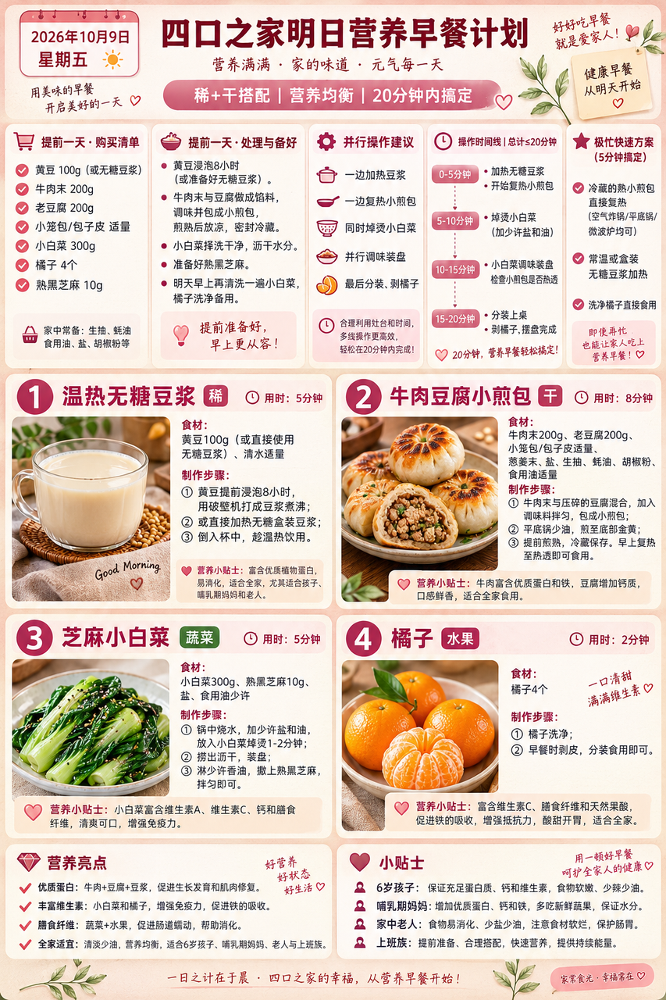
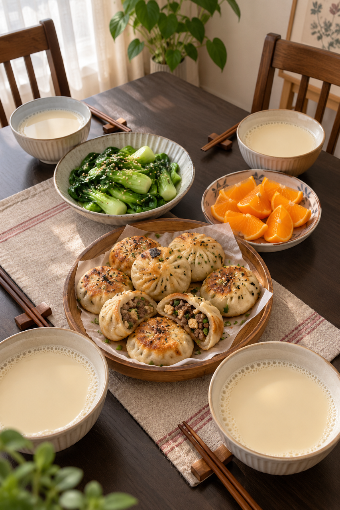
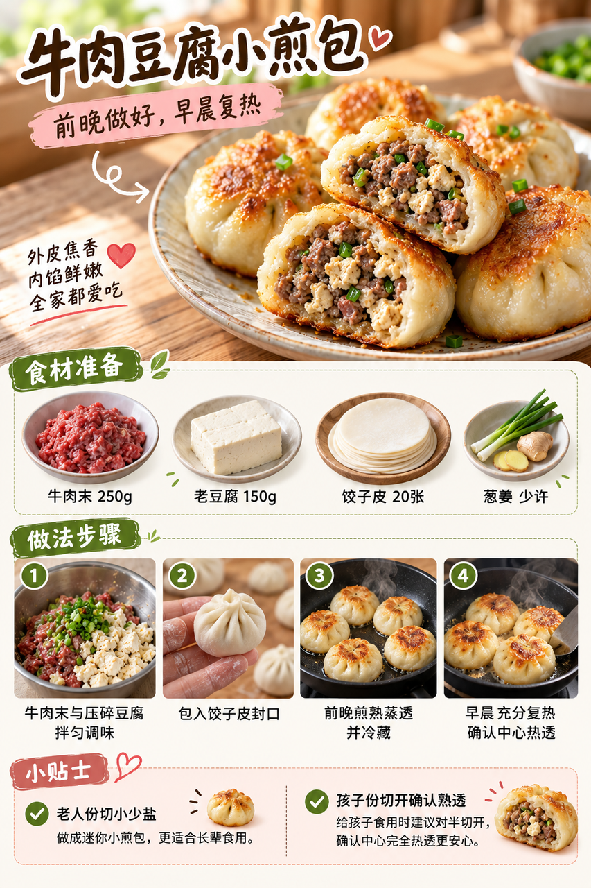

# 2026-10-09 早餐内容包

## 小红书标题

直接抄作业！牛肉豆腐小煎包早餐

## 小红书正文

今晚把牛肉豆腐小煎包煎熟蒸透后冷藏，小白菜洗净。明早一边复热小煎包，一边加热无糖豆浆、焯小白菜拌芝麻，最后剥橘子；四口之家20分钟吃上热乎的稀+干早餐。孩子份切开确认馅心热透，老人份切小少盐。极忙时用熟小煎包充分复热，配即饮无糖豆浆和橘子，5分钟上桌。关注我，明早继续抄作业。

## 流量标签

#创意手工开造计划 #oots街拍一下 #高敏感人看世界 #重述神话 #秋日时髦尖子生 #野生食评人howto #我的不完美料理 #一公里摄影大赛 #小红书校园身份卡 #勃艮第红

## 互动问题

明天我做 4 个版本：A. 小学生长高版 B. 老人好消化版 C. 上班族快手版 D. 评论区留下你专属版。你家更需要哪个？评论 A/B/C/D，我按票数发；选 D 的直接留下年龄、家庭人数、忌口和早上可用时间。关注我，明早直接抄作业。

## 置顶评论

想要「7天不重样早餐表」的，评论“7天”。选 D 的留下年龄、家庭人数、忌口和早上可用时间，我会挑典型家庭做专属版，后面每天更新。

## 明天预告

明天预告：不喝牛奶也高钙版，芝麻豆腐玉米卷配温热梨羹。

## 发布状态

草稿保存已暂停，未发布；ready_for_review；should_publish=false。

## 菜单与20分钟流程

- 温热无糖豆浆 + 牛肉豆腐小煎包 + 芝麻小白菜 + 橘子。
- 前晚准备：前晚将牛肉末250g和老豆腐150g拌馅，用约20张饺子皮包小煎包，煎熟后加水焖透，放凉及时冷藏；小白菜洗净沥干。
- 早晨流程：0–5分钟取出熟小煎包充分复热，同时加热即饮无糖豆浆；5–10分钟焯熟小白菜，捞出沥干切段；10–15分钟小白菜拌熟芝麻，确认小煎包中心热透；15–20分钟橘子去皮分瓣，按四人份分装上桌。
- 极忙5分钟：前晚已经熟透并冷藏的小煎包充分复热，配常温即饮无糖豆浆和橘子，5分钟。
- 预算：约40元/四人。

## 话题来源

来源日期：2026-10-08。[话题台账](weekly-hot-tags.json)。本地精选，不是独立核实官方热榜。

## 配图

[图1文件](01-breakfast-overview.png)

[图2文件](02-family-table.png)

[图3文件](03-beef-tofu-bun-process.png)

## 内容包与发布描述

[content-package.json](content-package.json)。图片按上述随机顺序排列；标题、正文、标签、互动问题、置顶评论和明天预告已同步。建议上海时间早间人工审阅；草稿保存已暂停，未发布。

## 图片核验

3 张最终图片均由 remove-ai-watermarks all 从独立 853×1280 源文件生成；identify --json 未检测到可识别水印或 metadata 信号。不可见水印阶段因缺少 GPU 依赖跳过，按 Skill 规则不拦截。详见 watermark-verification.json。 不据此宣称图片绝对无水印。
