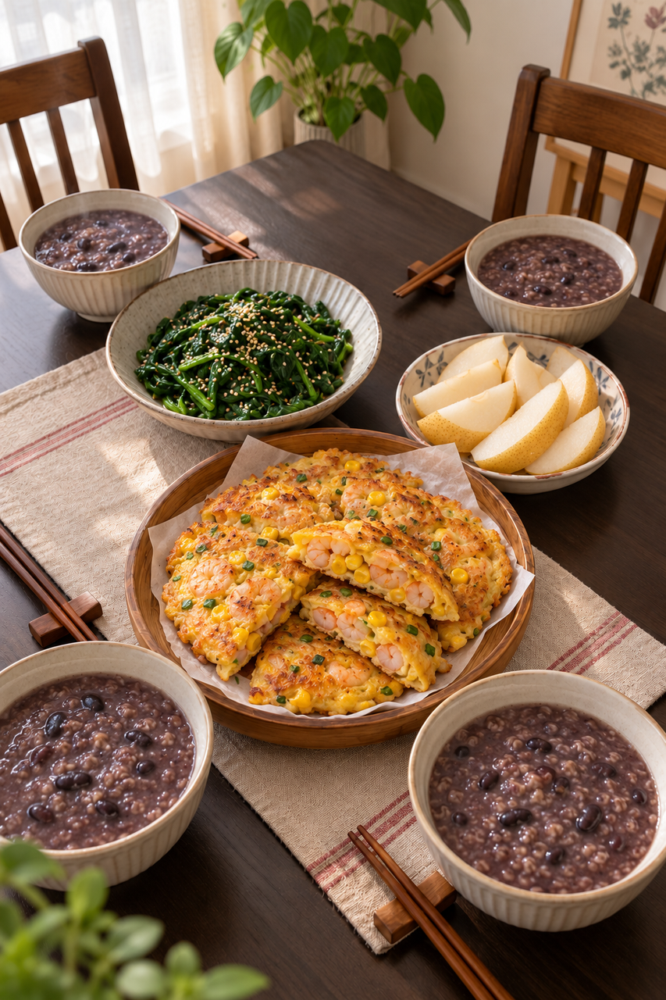
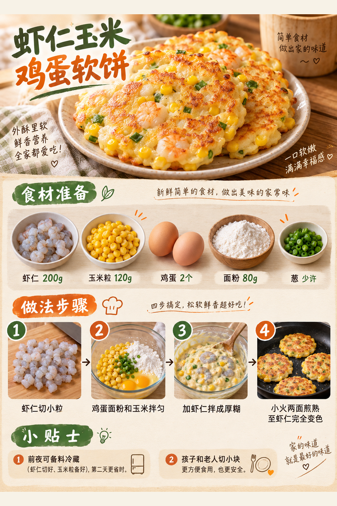
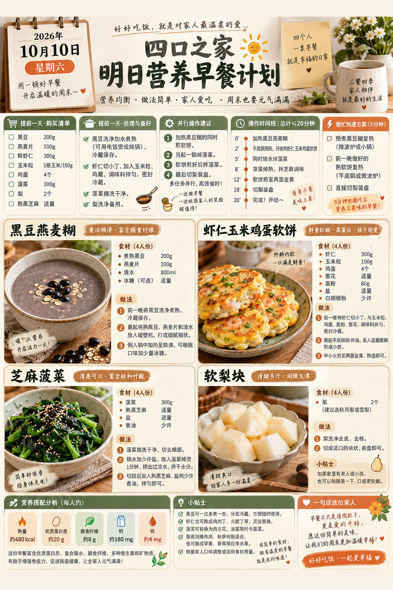

# 2026-10-10 早餐内容包

## 小红书标题

直接抄作业！虾仁玉米软饼早餐

## 小红书正文

今晚煮好黑豆并冷藏，虾仁切粒、玉米沥干，菠菜洗净。明早黑豆与燕麦加热成糊；鸡蛋、面粉、虾仁和玉米拌成厚糊，小火煎成软饼，翻面煎到虾仁完全变色；同时焯菠菜拌芝麻，梨切块。四口之家20分钟吃上稀+干。孩子份切小，老人份少盐；极忙时复热前夜熟饼和黑豆糊，配梨，5分钟上桌。关注我，明早继续抄作业。

## 流量标签

#创意手工开造计划 #oots街拍一下 #高敏感人看世界 #重述神话 #秋日时髦尖子生 #野生食评人howto #我的不完美料理 #一公里摄影大赛 #小红书校园身份卡 #勃艮第红

## 互动问题

明天我做 4 个版本：A. 小学生长高版 B. 老人好消化版 C. 上班族快手版 D. 评论区留下你专属版。你家更需要哪个？评论 A/B/C/D，我按票数发；选 D 的直接留下年龄、家庭人数、忌口和早上可用时间。关注我，明早直接抄作业。

## 置顶评论

想要「7天不重样早餐表」的，评论“7天”。选 D 的留下年龄、家庭人数、忌口和早上可用时间，我会挑典型家庭做专属版，后面每天更新。

## 明天预告

明天预告：不喝牛奶也高钙版，鱼肉豆腐馄饨配清爽时蔬。

## 发布状态

草稿保存已暂停，未发布；ready_for_review；should_publish=false。

## 菜单与20分钟流程

- 黑豆燕麦糊 + 虾仁玉米鸡蛋软饼 + 芝麻菠菜 + 软梨块。
- 前晚准备：前晚将干黑豆约120g充分煮熟，放凉后及时冷藏；虾仁200g切小粒冷藏，玉米粒120g沥干冷藏；菠菜300g洗净。
- 早晨流程：0–5分钟黑豆加燕麦约80g和水加热成糊；同时拌鸡蛋2个、面粉80g、虾仁和玉米成厚糊；5–10分钟平底锅少油小火下软饼，菠菜入沸水焯熟；10–15分钟软饼翻面煎至中心熟透、虾仁完全变色；菠菜沥水拌熟芝麻；15–20分钟梨切小块，按四人份分装黑豆糊、软饼、菠菜和梨。
- 极忙5分钟：前夜已煮熟的黑豆燕麦糊和已煎熟的软饼冷藏，早晨分别充分复热，配现切梨，约5分钟。
- 预算：约40元/四人。

## 话题来源

来源日期：2026-10-08。[话题台账](weekly-hot-tags.json)。本地精选，不是独立核实官方热榜。

## 配图

[图1文件](01-family-table.png)

[图2文件](02-shrimp-corn-pancake-process.png)

[图3文件](03-breakfast-overview.png)

## 内容包与发布描述

[content-package.json](content-package.json)。图片按上述随机顺序排列；标题、正文、标签、互动问题、置顶评论和明天预告已同步。建议上海时间早间人工审阅；草稿保存已暂停，未发布。

## 图片核验

3 张最终图片均由 remove-ai-watermarks all 从独立 853×1280 源文件生成；identify --json 未检测到可识别水印或 metadata 信号。不可见水印阶段因缺少 GPU 依赖跳过，按 Skill 规则不拦截。详见 watermark-verification.json。 不据此宣称图片绝对无水印。
