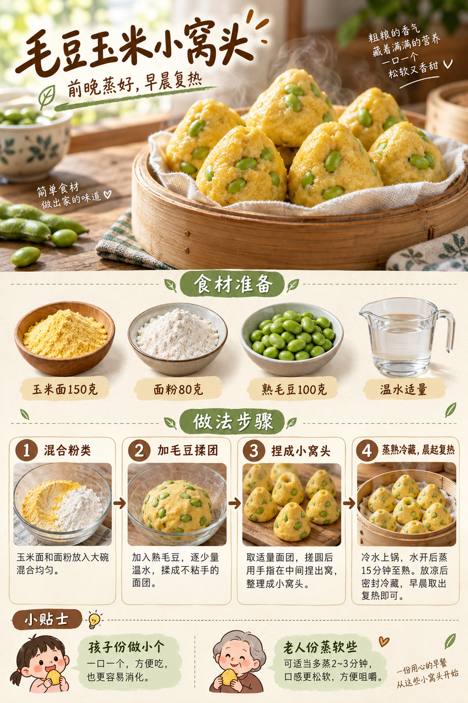
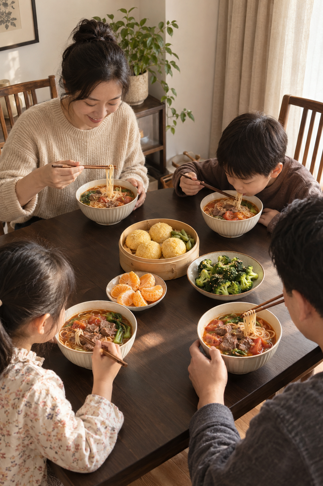
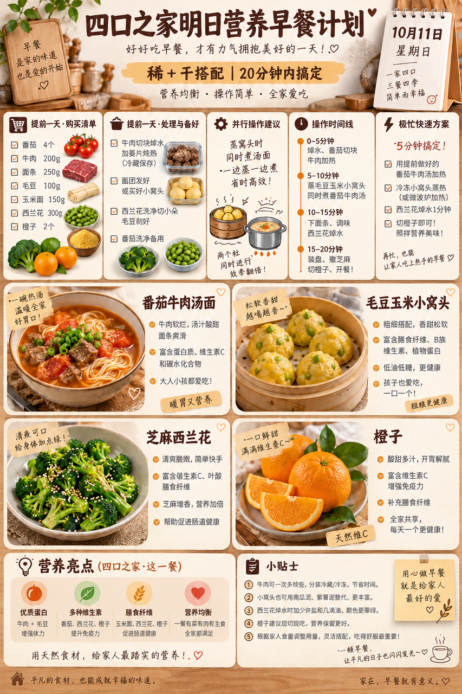

# 2026-10-11 早餐内容包

## 小红书标题

答应我，试试这碗番茄牛肉面

## 小红书正文

今晚把牛肉炖熟冷藏，小窝头提前蒸好，西兰花洗净。明早番茄煮开后加牛肉和面条；同时复热毛豆玉米小窝头，焯西兰花拌熟芝麻，再切橙子。四口之家20分钟吃上热乎的稀+干。孩子份面和牛肉剪小，老人份少盐、面煮软；极忙时复热前夜备好的汤面和小窝头，配橙子，5分钟上桌。关注我，明早继续抄作业。

## 流量标签

#创意手工开造计划 #oots街拍一下 #高敏感人看世界 #重述神话 #秋日时髦尖子生 #野生食评人howto #我的不完美料理 #一公里摄影大赛 #小红书校园身份卡 #勃艮第红

## 互动问题

明天我做 4 个版本：A. 小学生长高版 B. 老人好消化版 C. 上班族快手版 D. 评论区留下你专属版。你家更需要哪个？评论 A/B/C/D，我按票数发；选 D 的直接留下年龄、家庭人数、忌口和早上可用时间。关注我，明早直接抄作业。

## 置顶评论

想要「7天不重样早餐表」的，评论“7天”。选 D 的留下年龄、家庭人数、忌口和早上可用时间，我会挑典型家庭做专属版，后面每天更新。

## 明天预告

明天预告：不喝牛奶也高钙版，鱼肉豆腐馄饨配清爽时蔬。

## 发布状态

草稿保存已暂停，未发布；ready_for_review；should_publish=false。

## 菜单与20分钟流程

- 番茄牛肉汤面 + 毛豆玉米小窝头 + 芝麻西兰花 + 橙子。
- 前晚准备：前晚将牛肉约200g充分炖熟、汤与肉及时冷藏；毛豆100g煮熟，与玉米面150g、面粉80g拌匀捏成小窝头蒸熟冷藏；西兰花约300g洗净。
- 早晨流程：0–5分钟番茄2个切块入锅煮汤，另一锅蒸热前晚的小窝头；5–10分钟汤中加入前晚熟牛肉和挂面约250g，西兰花焯熟；10–15分钟面条煮透、牛肉复热至滚烫；西兰花拌熟芝麻；15–20分钟按四人份分装汤面、小窝头、西兰花和橙子。
- 极忙5分钟：前夜把番茄牛肉面和小窝头全部做熟并及时冷藏，晨起分别充分复热，配剥好的橙子，约5分钟。
- 预算：约40元/四人。

## 话题来源

来源日期：2026-10-08。[话题台账](weekly-hot-tags.json)。本地精选，不是独立核实官方热榜。

## 配图

[图1文件](01-edamame-corn-bun-process.png)

[图2文件](02-family-table.png)

[图3文件](03-breakfast-overview.png)

## 内容包与发布描述

[content-package.json](content-package.json)。图片按上述随机顺序排列；标题“答应我，试试这碗番茄牛肉面”、正文、10个标签、互动问题、置顶评论和明天预告已同步。建议上海时间早间人工审阅；草稿保存已暂停，未发布。

## 图片核验

3 张最终图片均由 remove-ai-watermarks all 从独立 853×1280 源文件生成；identify --json 未检测到可识别水印或 metadata 信号。不可见水印阶段因缺少 GPU 依赖跳过，按 Skill 规则不拦截。详见 watermark-verification.json。 不据此宣称图片绝对无水印。
