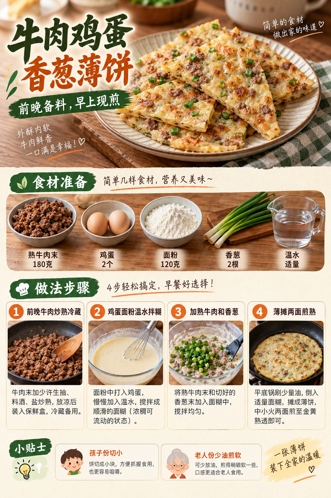
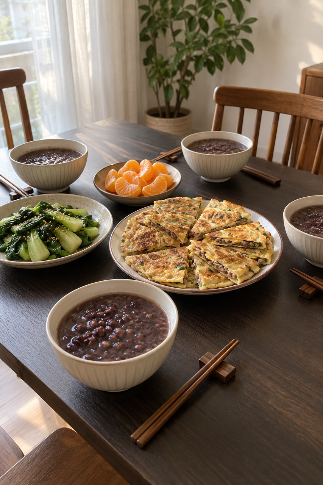
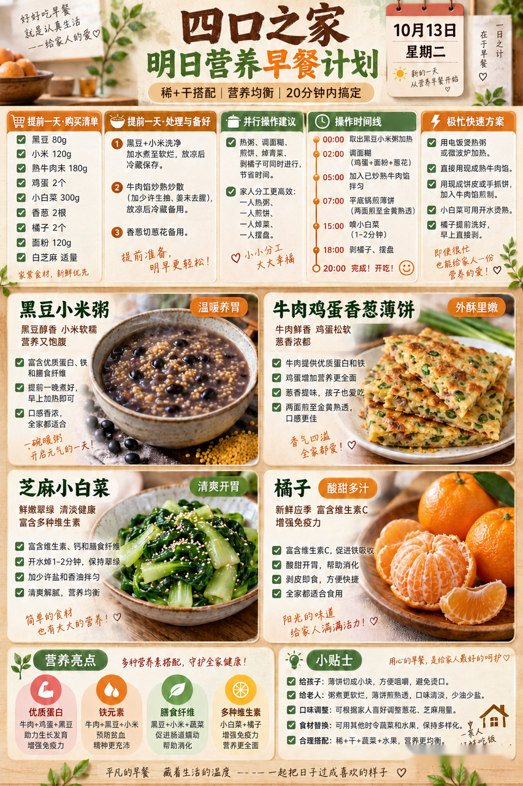

# 2026-10-13 早餐内容包

## 小红书标题

有手就会！牛肉鸡蛋薄饼早餐

## 小红书正文

今晚把黑豆小米粥煮好冷藏，牛肉末炒熟分装，小白菜洗净。明早热粥时拌鸡蛋面糊，加牛肉末和香葱薄摊煎透；焯小白菜拌熟芝麻，剥橘子。四口之家20分钟吃上热乎的稀+干。孩子份薄饼切小块，老人份煎软少油；赶时间就把前夜做熟的粥和薄饼充分复热，配橘子，5分钟上桌。关注我，明早继续抄作业。

## 流量标签

#创意手工开造计划 #oots街拍一下 #高敏感人看世界 #重述神话 #秋日时髦尖子生 #野生食评人howto #我的不完美料理 #一公里摄影大赛 #小红书校园身份卡 #勃艮第红

## 互动问题

明天我做 4 个版本：A. 小学生长高版 B. 老人好消化版 C. 上班族快手版 D. 评论区留下你专属版。你家更需要哪个？评论 A/B/C/D，我按票数发；选 D 的直接留下年龄、家庭人数、忌口和早上可用时间。关注我，明早直接抄作业。

## 置顶评论

想要「7天不重样早餐表」的，评论“7天”。选 D 的留下年龄、家庭人数、忌口和早上可用时间，我会挑典型家庭做专属版，后面每天更新。

## 明天预告

明天预告：鱼肉豆腐小馄饨配秋日时蔬，软和又暖胃。

## 发布状态

草稿保存已暂停，未发布；ready_for_review；should_publish=false。

## 菜单与20分钟流程

- 黑豆小米粥 + 牛肉鸡蛋香葱薄饼 + 芝麻小白菜 + 橘子。
- 前晚准备：前晚将黑豆80g泡发并与小米120g充分煮软，及时冷藏；牛肉末180g彻底炒熟并及时冷藏；小白菜300g洗净沥水。
- 早晨流程：0–5分钟充分加热前夜黑豆小米粥；鸡蛋2个、面粉120g和温水调成稀面糊；5–10分钟加入熟牛肉末与香葱，平底锅薄摊第一面；10–15分钟翻面煎至鸡蛋和面糊全熟；另锅焯熟小白菜；15–20分钟小白菜拌熟白芝麻，剥2个橘子并分装四人份。
- 极忙5分钟：前晚把薄饼和粥都充分做熟并及时冷藏；晨起把粥与薄饼分别彻底复热，配前晚洗好的橘子，约5分钟上桌。
- 预算：约40元/四人。

## 话题来源

来源日期：2026-10-08。[话题台账](weekly-hot-tags.json)。本地精选，不是独立核实官方热榜。

## 配图

[图1文件](01-beef-egg-pancake-process.png)

[图2文件](02-family-table.png)

[图3文件](03-breakfast-overview.png)

## 内容包与发布描述

[content-package.json](content-package.json)。图片按上述随机顺序排列；标题“有手就会！牛肉鸡蛋薄饼早餐”、正文、10个标签、互动问题、置顶评论和明天预告已同步。建议上海时间早间人工审阅；草稿保存已暂停，未发布。

## 图片核验

3 张最终图片均由 remove-ai-watermarks all 从独立 853×1280 源文件生成；identify --json 未检测到可识别水印或 metadata 信号。不可见水印阶段因缺少 GPU 依赖跳过，按 Skill 规则不拦截。详见 watermark-verification.json。 不据此宣称图片绝对无水印。
