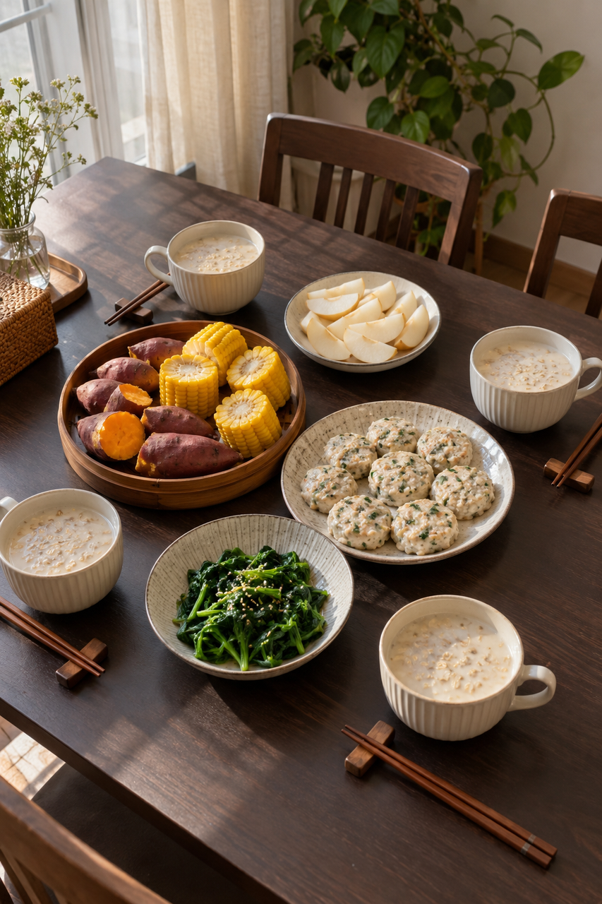
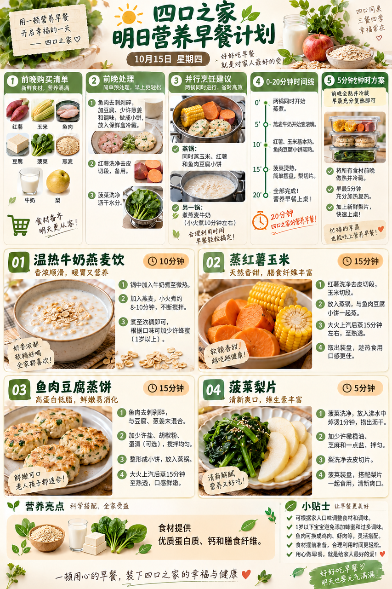
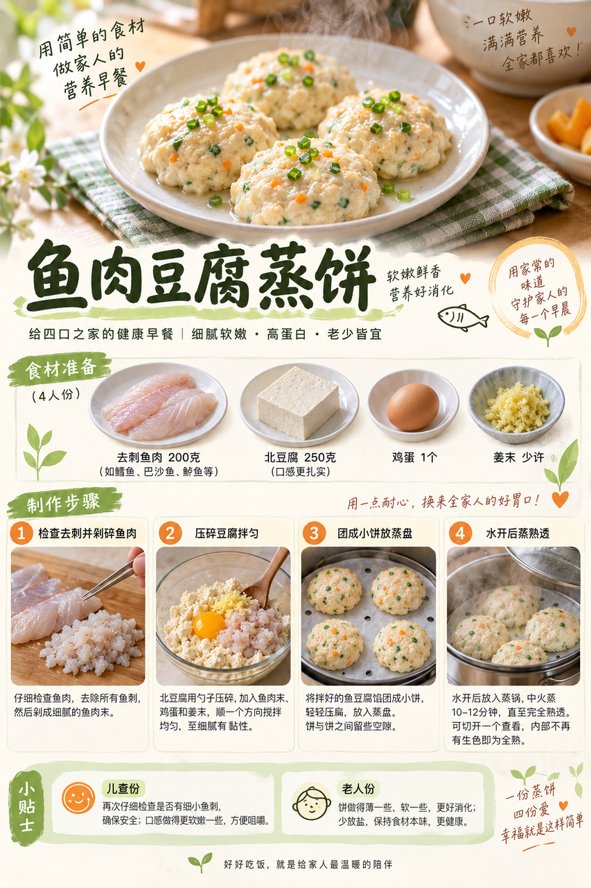

# 2026-10-15 早餐内容包

## 小红书标题

直接抄作业！红薯玉米蒸饼早餐

## 小红书正文

今晚把红薯切块、玉米切段，鱼肉仔细去刺，和豆腐、鸡蛋拌匀做小饼，盖好冷藏。明早红薯玉米与鱼肉豆腐饼分层同蒸，另锅煮温热牛奶燕麦、焯菠菜，梨切片。20分钟端出四口之家的稀+干；孩子份再查鱼刺，老人份蒸软少盐。极忙时用前夜已蒸熟并及时冷藏的食物彻底复热，5分钟上桌。关注我，明早继续抄作业。

## 流量标签

#创意手工开造计划 #oots街拍一下 #高敏感人看世界 #重述神话 #秋日时髦尖子生 #野生食评人howto #我的不完美料理 #一公里摄影大赛 #小红书校园身份卡 #勃艮第红

## 互动问题

明天我做 4 个版本：A. 小学生长高版 B. 老人好消化版 C. 上班族快手版 D. 评论区留下你专属版。你家更需要哪个？评论 A/B/C/D，我按票数发；选 D 的直接留下年龄、家庭人数、忌口和早上可用时间。关注我，明早直接抄作业。

## 置顶评论

想要「7天不重样早餐表」的，评论“7天”。选 D 的留下年龄、家庭人数、忌口和早上可用时间，我会挑典型家庭做专属版，后面每天更新。

## 明天预告

明天预告：不喝牛奶也能搭配的温热高钙早餐。

## 发布状态

草稿保存已暂停，未发布；ready_for_review；should_publish=false。

## 菜单与20分钟流程

- 温热牛奶燕麦饮 + 蒸红薯玉米 + 鱼肉豆腐蒸饼 + 菠菜梨片。
- 前晚准备：前晚鱼肉200g仔细去刺剁碎，与北豆腐250g、鸡蛋1个、姜末拌匀成小饼，加盖放入4℃以下冰箱；红薯500g洗净切小块、玉米2根切段，菠菜300g洗净。生熟分开，次日早晨蒸熟。
- 早晨流程：0–5分钟蒸锅烧水，红薯小块和玉米段入锅；另一锅加热牛奶500ml与燕麦100g；5–10分钟鱼肉豆腐小饼放上层蒸屉并持续蒸，燕麦煮至软稠；10–15分钟另锅将菠菜焯熟，梨2个洗净切片；15–20分钟确认鱼肉豆腐饼内部全熟、红薯软透，四人分装；孩子份再次检查鱼刺。
- 极忙5分钟：前夜将全部蒸食和燕麦饮做熟后及时冷藏；早晨把蒸食与燕麦饮分别充分复热，配洗净切好的梨片，约5分钟上桌。
- 预算：约40元/四人。

## 话题来源

来源日期：2026-10-08。[话题台账](weekly-hot-tags.json)。本地精选，不是独立核实官方热榜。

## 配图

[图1文件](01-family-table.png)

[图2文件](02-breakfast-overview.png)

[图3文件](03-fish-tofu-process.png)

## 内容包与发布描述

[content-package.json](content-package.json)。图片按上述随机顺序排列；标题、正文、10个标签、互动问题、置顶评论和明天预告已同步。建议上海时间早间人工审阅；草稿保存已暂停，未发布。

## 图片核验

3 张最终图片均由 remove-ai-watermarks all 从独立 853×1280 源文件生成；identify --json 未检测到可识别水印或 metadata 信号。不可见水印阶段因缺少 GPU 依赖跳过，按 Skill 规则不拦截。详见 watermark-verification.json。 不据此宣称图片绝对无水印。
