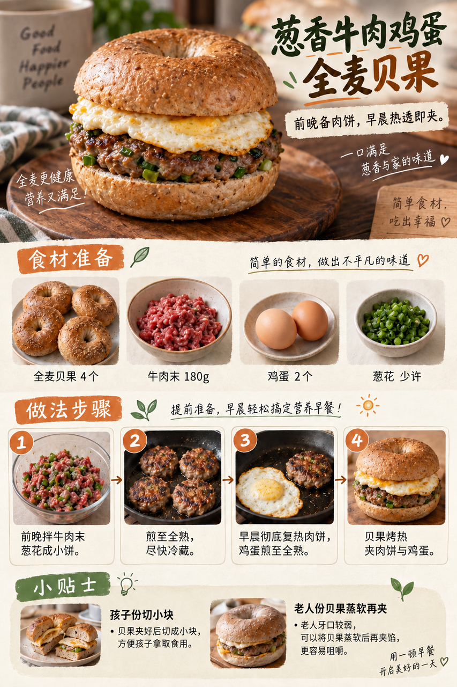
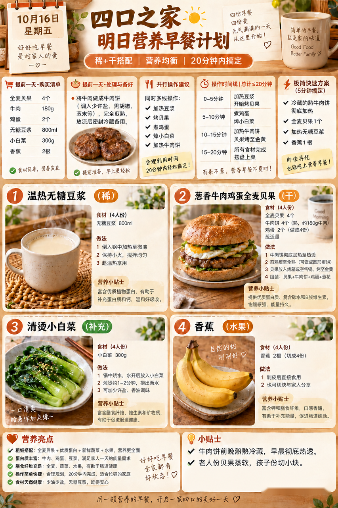
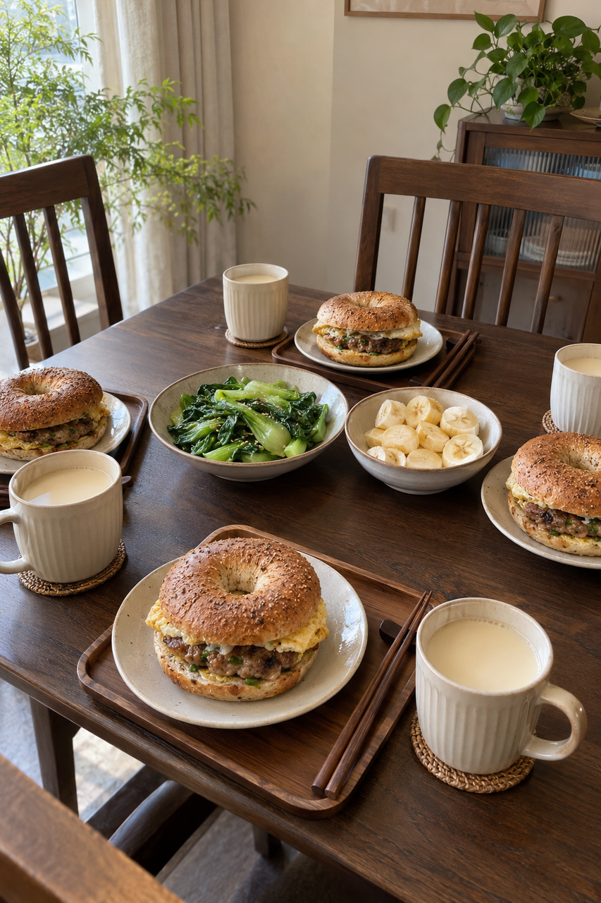

# 2026-10-16 早餐内容包

## 小红书标题

答应我，明早试试牛肉鸡蛋贝果

## 小红书正文

今晚把牛肉末加葱花做成小饼，煎至全熟后及时冷藏。明早彻底复热肉饼，鸡蛋煎全熟，贝果烤热后夹好；同时温热无糖豆浆、焯小白菜，香蕉切段。四口之家约20分钟吃上稀+干，孩子份切小块，老人份贝果蒸软。极忙时用前夜熟肉饼充分复热，配贝果、豆浆和香蕉，5分钟开饭。关注我，明早继续抄作业。

## 流量标签

#创意手工开造计划 #oots街拍一下 #高敏感人看世界 #重述神话 #秋日时髦尖子生 #野生食评人howto #我的不完美料理 #一公里摄影大赛 #小红书校园身份卡 #勃艮第红

## 互动问题

明天我做 4 个版本：A. 小学生长高版 B. 老人好消化版 C. 上班族快手版 D. 评论区留下你专属版。你家更需要哪个？评论 A/B/C/D，我按票数发；选 D 的直接留下年龄、家庭人数、忌口和早上可用时间。关注我，明早直接抄作业。

## 置顶评论

想要「7天不重样早餐表」的，评论“7天”。选 D 的留下年龄、家庭人数、忌口和早上可用时间，我会挑典型家庭做专属版，后面每天更新。

## 明天预告

明天预告：周末不赶时间的虾仁豆腐汤面早餐。

## 发布状态

草稿保存已暂停，未发布；ready_for_review；should_publish=false。

## 菜单与20分钟流程

- 温热无糖豆浆 + 葱香牛肉鸡蛋全麦贝果 + 清烫小白菜 + 香蕉。
- 前晚准备：前晚将牛肉末180g与葱花拌匀做成4个薄肉饼，煎至内部全熟，及时放入4℃以下冰箱；小白菜300g洗净沥干，生熟分开。贝果4个、鸡蛋2个、无糖豆浆800ml、香蕉2根备好。
- 早晨流程：0–5分钟：煎锅加热并彻底复热前夜熟牛肉饼；另锅温热无糖豆浆；5–10分钟：鸡蛋煎至蛋黄蛋白均全熟；贝果切开烤热；10–15分钟：小白菜焯熟，香蕉剥皮切段；老人份贝果略蒸软；15–20分钟：确认肉饼中心热透，贝果夹入肉饼与鸡蛋，按四人分装
- 极忙5分钟：前夜已煎熟并及时冷藏的牛肉饼用微波炉充分复热，与全麦贝果、温热无糖豆浆和香蕉搭配；约5分钟完成。
- 预算：约40元/四人。

## 话题来源

来源日期：2026-10-08。[话题台账](weekly-hot-tags.json)。本地精选，不是独立核实官方热榜。

## 配图

[图1文件](01-beef-bagel-process.png)

[图2文件](02-breakfast-overview.png)

[图3文件](03-family-table.png)

## 内容包与发布描述

[content-package.json](content-package.json)。建议上海时间早间人工审阅；图片按上述随机顺序排列。标题：答应我，明早试试牛肉鸡蛋贝果；正文：今晚把牛肉末加葱花做成小饼，煎至全熟后及时冷藏。明早彻底复热肉饼，鸡蛋煎全熟，贝果烤热后夹好；同时温热无糖豆浆、焯小白菜，香蕉切段。四口之家约20分钟吃上稀+干，孩子份切小块，老人份贝果蒸软。极忙时用前夜熟肉饼充分复热，配贝果、豆浆和香蕉，5分钟开饭。关注我，明早继续抄作业。；标签：#创意手工开造计划 #oots街拍一下 #高敏感人看世界 #重述神话 #秋日时髦尖子生 #野生食评人howto #我的不完美料理 #一公里摄影大赛 #小红书校园身份卡 #勃艮第红；互动：明天我做 4 个版本：A. 小学生长高版 B. 老人好消化版 C. 上班族快手版 D. 评论区留下你专属版。你家更需要哪个？评论 A/B/C/D，我按票数发；选 D 的直接留下年龄、家庭人数、忌口和早上可用时间。关注我，明早直接抄作业。；置顶评论：想要「7天不重样早餐表」的，评论“7天”。选 D 的留下年龄、家庭人数、忌口和早上可用时间，我会挑典型家庭做专属版，后面每天更新。；明天预告：明天预告：周末不赶时间的虾仁豆腐汤面早餐。。草稿保存已暂停，未发布。

## 图片核验

3 张最终图片均由 remove-ai-watermarks all 从独立 853×1280 源文件生成；identify --json 未检测到可识别水印或 metadata 信号。不可见水印阶段因缺少 GPU 依赖跳过，按 Skill 规则不拦截。详见 watermark-verification.json。 不据此宣称图片绝对无水印。
