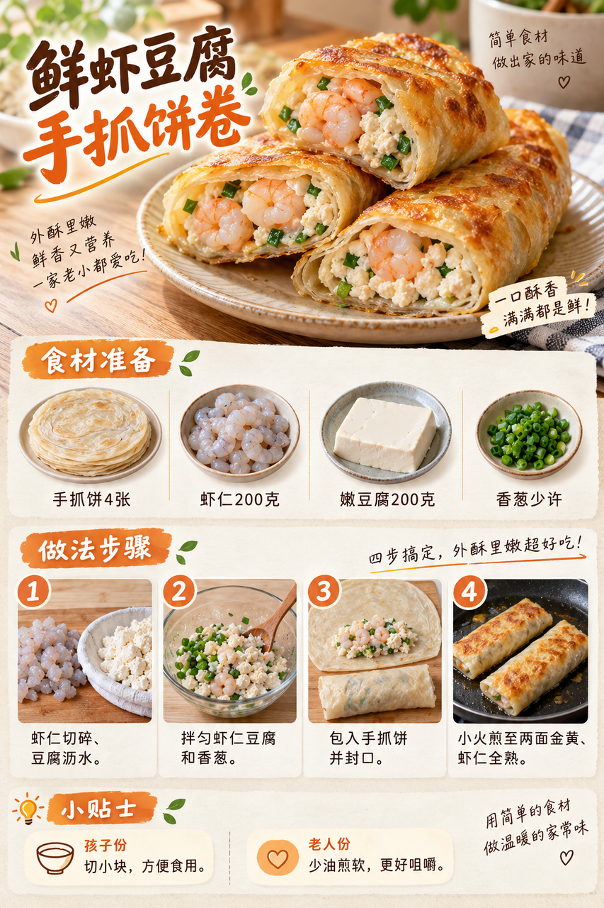
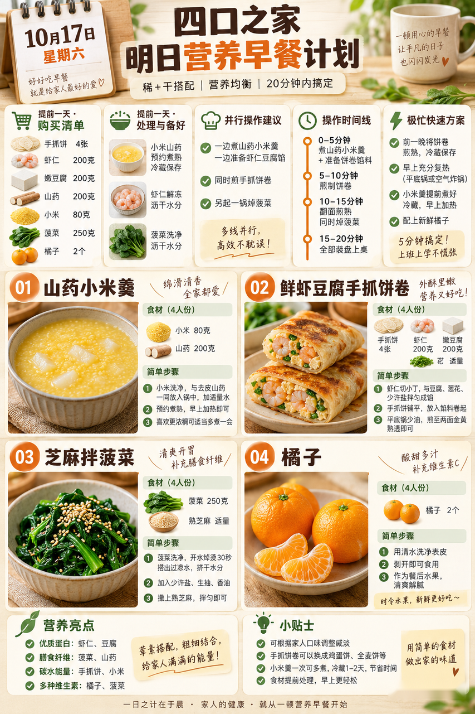
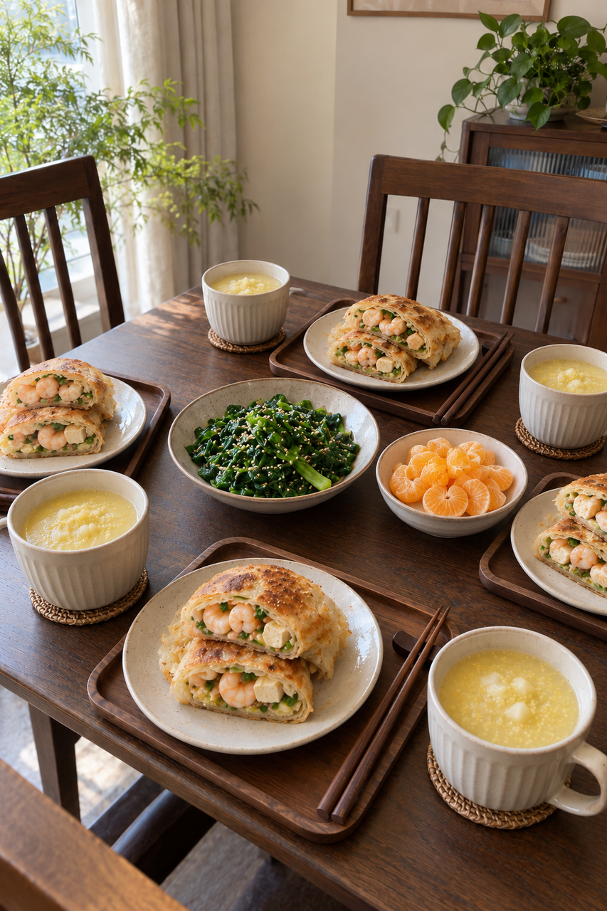

# 2026-10-17 早餐内容包

## 小红书标题

直接抄作业！鲜虾豆腐饼卷早餐

## 小红书正文

今晚把小米、山药煮熟并及时冷藏，虾仁解冻沥干，菠菜洗好。明早把虾仁和豆腐拌匀包进手抓饼，小火煎到虾仁全熟；同时热羹、焯菠菜，橘子剥好。四口之家20分钟吃上稀+干，孩子份切小块，老人份饼煎软。极忙时复热前夜熟制饼卷，配预煮小米羹和橘子，5分钟开饭。关注我，明早继续抄作业。

## 流量标签

#这次旅行local一下 #10月16日双十一预售 #10月18日重阳节 #10月23日霜降 #抽象力 #科学健身与体重管理 #主体性 #反精致 #一公里摄影大赛 #10月31日万圣节

## 互动问题

明天我做 4 个版本：A. 小学生长高版 B. 老人好消化版 C. 上班族快手版 D. 评论区留下你专属版。你家更需要哪个？评论 A/B/C/D，我按票数发；选 D 的直接留下年龄、家庭人数、忌口和早上可用时间。关注我，明早直接抄作业。

## 置顶评论

想要「7天不重样早餐表」的，评论“7天”。选 D 的留下年龄、家庭人数、忌口和早上可用时间，我会挑典型家庭做专属版，后面每天更新。

## 明天预告

明天预告：给老人做一碗软和的鱼片小馄饨。

## 发布状态

草稿保存已暂停，未发布；ready_for_review；should_publish=false。

## 菜单与20分钟流程

- 山药小米羹 + 鲜虾豆腐手抓饼卷 + 芝麻拌菠菜 + 橘子。
- 前晚准备：前晚煮熟小米80g与山药200g，及时冷却并放入4℃以下冰箱；虾仁200g在冰箱冷藏解冻，嫩豆腐200g沥水，菠菜250g洗净。手抓饼4张与橘子2个备好，生熟分开。
- 早晨流程：0–5分钟：彻底加热前夜山药小米羹，虾仁切碎、豆腐沥水拌香葱；5–10分钟：把馅包入手抓饼，小火煎第一面；另锅烧水；10–15分钟：翻面煎至虾仁全熟，同时把菠菜焯熟拌芝麻；15–20分钟：饼卷切开确认虾仁熟透，橘子剥好，四人分装
- 极忙5分钟：前夜已煎至全熟并及时冷藏的鲜虾豆腐饼卷，次日彻底复热，配充分热透的预煮山药小米羹和新鲜橘子；约5分钟完成。
- 预算：约40元/四人。

## 话题来源

来源日期：2026-10-16。[话题台账](weekly-hot-tags.json)。本地精选，不是独立核实官方热榜。

## 配图

[图1文件](01-shrimp-tofu-wrap-process.png)

[图2文件](02-breakfast-overview.png)

[图3文件](03-family-table.png)

## 内容包与发布描述

[content-package.json](content-package.json)。建议上海时间早间人工审阅；图片按上述随机顺序排列。标题：直接抄作业！鲜虾豆腐饼卷早餐；正文：今晚把小米、山药煮熟并及时冷藏，虾仁解冻沥干，菠菜洗好。明早把虾仁和豆腐拌匀包进手抓饼，小火煎到虾仁全熟；同时热羹、焯菠菜，橘子剥好。四口之家20分钟吃上稀+干，孩子份切小块，老人份饼煎软。极忙时复热前夜熟制饼卷，配预煮小米羹和橘子，5分钟开饭。关注我，明早继续抄作业。；标签：#这次旅行local一下 #10月16日双十一预售 #10月18日重阳节 #10月23日霜降 #抽象力 #科学健身与体重管理 #主体性 #反精致 #一公里摄影大赛 #10月31日万圣节；互动：明天我做 4 个版本：A. 小学生长高版 B. 老人好消化版 C. 上班族快手版 D. 评论区留下你专属版。你家更需要哪个？评论 A/B/C/D，我按票数发；选 D 的直接留下年龄、家庭人数、忌口和早上可用时间。关注我，明早直接抄作业。；置顶评论：想要「7天不重样早餐表」的，评论“7天”。选 D 的留下年龄、家庭人数、忌口和早上可用时间，我会挑典型家庭做专属版，后面每天更新。；明天预告：明天预告：给老人做一碗软和的鱼片小馄饨。。草稿保存已暂停，未发布。

## 图片核验

3 张最终图片均由 remove-ai-watermarks all 从独立 853×1280 源文件生成；identify --json 未检测到可识别水印或 metadata 信号。不可见水印阶段因缺少 GPU 依赖跳过，按 Skill 规则不拦截。详见 watermark-verification.json。 不据此宣称图片绝对无水印。
