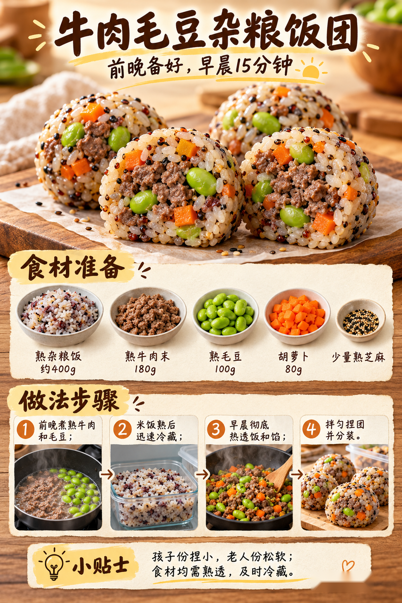
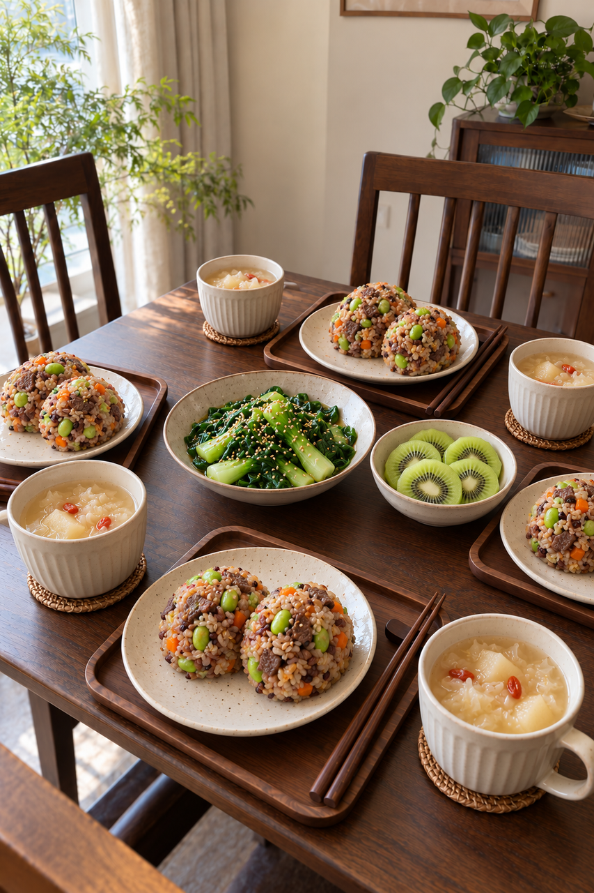

# 2026-10-18 早餐内容包

## 小红书标题

直接抄作业！牛肉毛豆饭团早餐

## 小红书正文

今晚把杂粮饭、牛肉末、毛豆和胡萝卜分别做熟，及时冷藏；银耳雪梨羹也提前煮好。明早先把饭和馅彻底热透，拌匀捏成小饭团，同时热羹、焯小油菜，猕猴桃切好。四口之家20分钟吃上稀+干；老人份捏松软，孩子份切小块。极忙时复热前夜做熟的饭团和梨羹，5分钟开饭。关注我，明早继续抄作业。

## 流量标签

#这次旅行local一下 #10月16日双十一预售 #10月18日重阳节 #10月23日霜降 #抽象力 #科学健身与体重管理 #主体性 #反精致 #一公里摄影大赛 #10月31日万圣节

## 互动问题

明天我做 4 个版本：A. 小学生长高版 B. 老人好消化版 C. 上班族快手版 D. 评论区留下你专属版。你家更需要哪个？评论 A/B/C/D，我按票数发；选 D 的直接留下年龄、家庭人数、忌口和早上可用时间。关注我，明早直接抄作业。

## 置顶评论

想要「7天不重样早餐表」的，评论“7天”。选 D 的留下年龄、家庭人数、忌口和早上可用时间，我会挑典型家庭做专属版，后面每天更新。

## 明天预告

明天预告：做一套不喝牛奶也能吃得丰富的中式早餐。

## 发布状态

草稿保存已暂停，未发布；ready_for_review；should_publish=false。

## 菜单与20分钟流程

- 银耳雪梨羹 + 牛肉毛豆杂粮饭团 + 芝麻小油菜 + 猕猴桃。
- 前晚准备：前晚煮熟杂粮饭约400g，牛肉末180g、毛豆100g、胡萝卜80g分别做熟；尽快分装并放入4℃以下冰箱。银耳和梨煮成羹，及时冷藏；小油菜洗净，猕猴桃备好。
- 早晨流程：0–5分钟：银耳雪梨羹、杂粮饭和熟牛肉毛豆馅分别加热至热透；5–10分钟：另锅焯熟小油菜，沥水拌少量熟芝麻；10–15分钟：把热饭和热馅拌匀，捏成小而松软的饭团；15–20分钟：羹和菜分装，猕猴桃去皮切小块，核对饭团中心热透
- 极忙5分钟：前夜已完全做熟并及时冷藏的牛肉毛豆饭团和银耳雪梨羹，次日分别充分复热，配即食猕猴桃；约5分钟完成。
- 预算：约40元/四人。

## 话题来源

来源日期：2026-10-16。[话题台账](weekly-hot-tags.json)。本地精选，不是独立核实官方热榜。

## 配图

[图1文件](01-breakfast-overview.png)

[图2文件](02-beef-edamame-riceball-process.png)

[图3文件](03-family-table.png)

## 内容包与发布描述

[content-package.json](content-package.json)。建议上海时间早间人工审阅；图片按上述随机顺序排列。标题：直接抄作业！牛肉毛豆饭团早餐；正文：今晚把杂粮饭、牛肉末、毛豆和胡萝卜分别做熟，及时冷藏；银耳雪梨羹也提前煮好。明早先把饭和馅彻底热透，拌匀捏成小饭团，同时热羹、焯小油菜，猕猴桃切好。四口之家20分钟吃上稀+干；老人份捏松软，孩子份切小块。极忙时复热前夜做熟的饭团和梨羹，5分钟开饭。关注我，明早继续抄作业。；标签：#这次旅行local一下 #10月16日双十一预售 #10月18日重阳节 #10月23日霜降 #抽象力 #科学健身与体重管理 #主体性 #反精致 #一公里摄影大赛 #10月31日万圣节；互动：明天我做 4 个版本：A. 小学生长高版 B. 老人好消化版 C. 上班族快手版 D. 评论区留下你专属版。你家更需要哪个？评论 A/B/C/D，我按票数发；选 D 的直接留下年龄、家庭人数、忌口和早上可用时间。关注我，明早直接抄作业。；置顶评论：想要「7天不重样早餐表」的，评论“7天”。选 D 的留下年龄、家庭人数、忌口和早上可用时间，我会挑典型家庭做专属版，后面每天更新。；明天预告：明天预告：做一套不喝牛奶也能吃得丰富的中式早餐。。草稿保存已暂停，未发布。

## 图片核验

3 张最终图片均由 remove-ai-watermarks all 从独立 853×1280 源文件生成；identify --json 未检测到可识别水印或 metadata 信号。不可见水印阶段因缺少 GPU 依赖跳过，按 Skill 规则不拦截。详见 watermark-verification.json。 不据此宣称图片绝对无水印。
