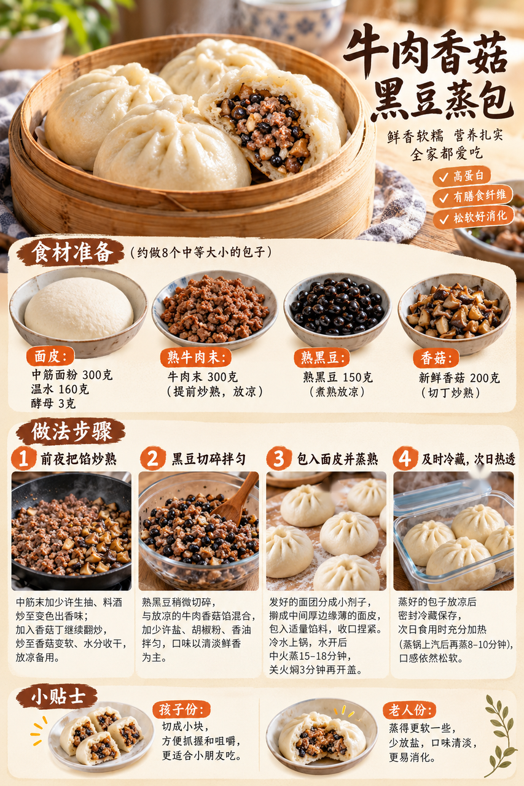
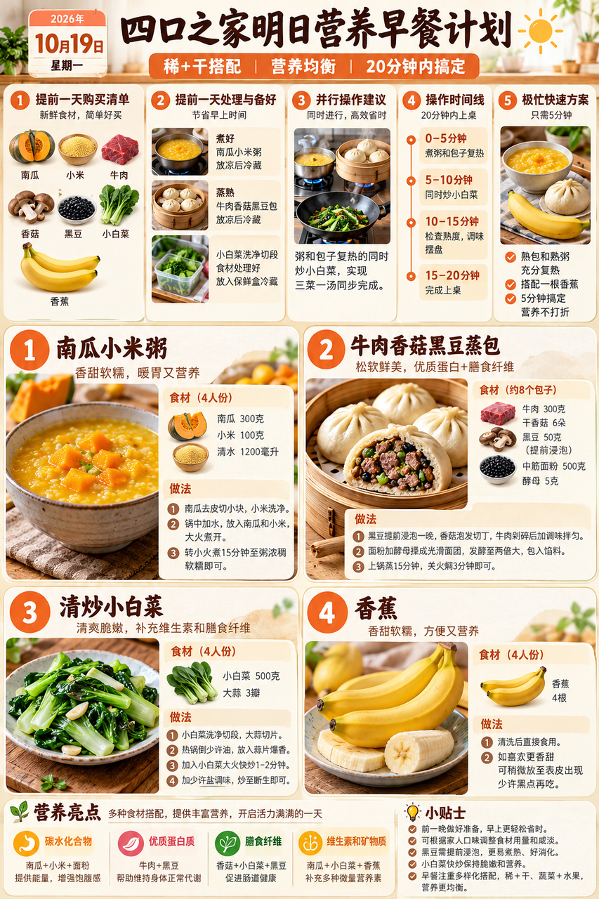
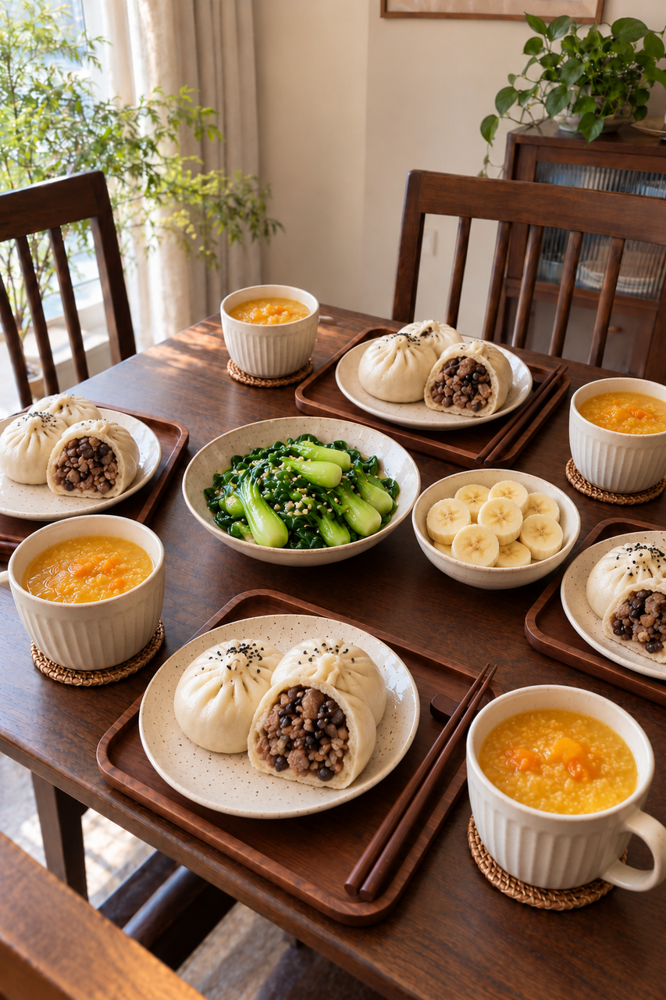

# 2026-10-19 四口之家早餐内容包

## 小红书标题

答应我，试试这份牛肉蒸包早餐

## 小红书正文

今晚把黑豆煮透，牛肉香菇馅炒熟，包子蒸熟后及时冷藏；南瓜小米粥也提前煮好。明早先把粥和包子充分热透，同时炒小白菜、切香蕉，20分钟端上桌。女儿份包子切小块，妈妈多分一只，老人份蒸软少盐。极忙时用前夜已熟并冷藏的粥和包子分装热透，配香蕉，约5分钟。关注我，明早继续抄作业。

## 流量标签

#这次旅行local一下 #10月16日双十一预售 #10月18日重阳节 #10月23日霜降 #抽象力 #科学健身与体重管理 #主体性 #反精致 #一公里摄影大赛 #10月31日万圣节

话题来源：2026-10-16 点点 Top10，本地精选，未独立验证官方热榜。见 [热词台账](weekly-hot-tags.json)。

## 配图

1. 牛肉香菇黑豆蒸包制作过程：[01-beef-blackbean-bun-process.png](01-beef-blackbean-bun-process.png)

2. 暖橙与日式木色高密度早餐计划：[02-breakfast-overview.png](02-breakfast-overview.png)

3. 四口之家固定餐桌与完整早餐：[03-family-table.png](03-family-table.png)

## 互动问题 A/B/C/D

明天我做 4 个版本：A. 小学生长高版 B. 老人好消化版 C. 上班族快手版 D. 评论区留下你专属版。你家更需要哪个？评论 A/B/C/D，我按票数发；选 D 的直接留下年龄、家庭人数、忌口和早上可用时间。关注我，明早直接抄作业。

## 置顶评论

想要「7天不重样早餐表」的，评论“7天”。选 D 的留下年龄、家庭人数、忌口和早上可用时间，我会挑典型家庭做专属版，后面每天更新。

## 明天预告

明天预告：做一套不喝牛奶也有优质蛋白的中式早餐。

## 前晚准备与早晨流程

前晚黑豆煮透，牛肉末和香菇炒熟；包成约8个中等蒸包并彻底蒸熟，放凉后及时冷藏。南瓜小米粥煮熟及时冷藏，小白菜洗净沥干，香蕉备好。

- 0–5分钟：包子上锅复蒸，同时加热前晚煮熟的南瓜小米粥
- 5–10分钟：检查包子中心热透；小白菜入锅炒熟
- 10–15分钟：粥持续加热至热透，包子分装给四人
- 15–20分钟：香蕉切片，孩子份包子切小块，老人份再蒸软

**极忙 5 分钟方案：**前夜已彻底做熟并及时冷藏的包子和南瓜小米粥分装后用微波炉充分热透，配香蕉；设备可同时加热四份时约5分钟。

## 发布描述

图片按上方顺序上传；标题、正文、10 个话题、互动问题、置顶评论、明天预告均见本页。建议在早餐时段人工确认内容和账号后再处理；当前仅存内容包。

## 状态

草稿保存已暂停、未发布。未进入 Tiny.C 创作中心。

## 文件

- [结构化内容包](content-package.json)
- [热词台账](weekly-hot-tags.json)
- [水印核验记录](watermark-verification.json)
