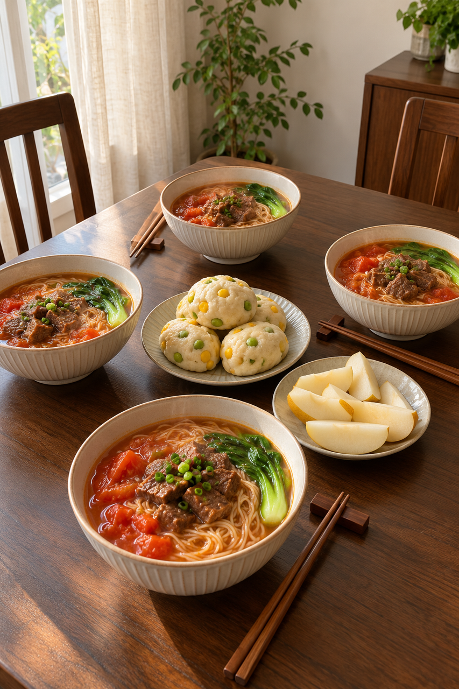
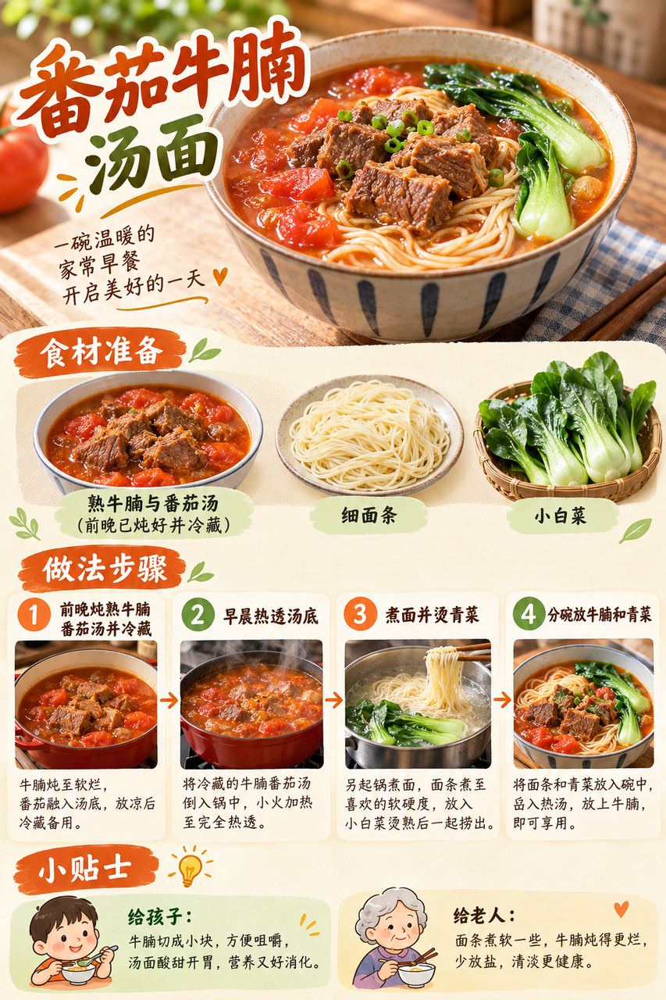
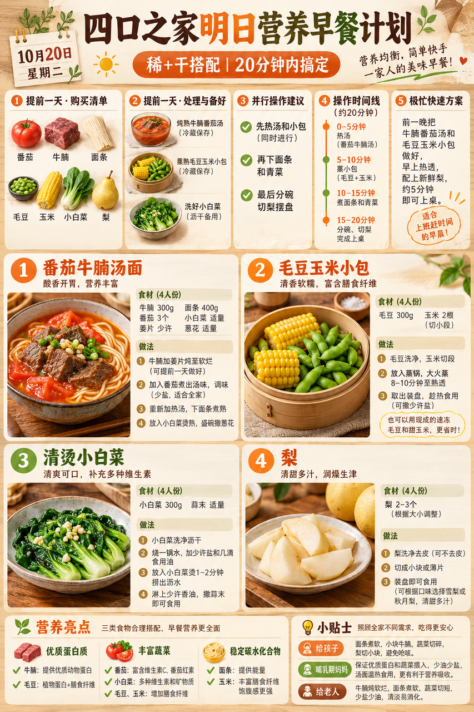

# 2026-10-20 四口之家早餐内容包

## 小红书标题

直接抄作业！番茄牛腩汤面早餐

## 小红书正文

前晚把牛腩番茄汤炖熟、毛豆玉米小包蒸熟，放凉后及时冷藏；小白菜洗净。明早同时热汤蒸包，下面条、烫青菜，切梨，20分钟端上桌。女儿牛腩切小块，老人面煮软少盐；哺乳期妈妈多分牛腩。极忙时把前夜熟汤和小包充分热透，配梨，约5分钟。关注我，明早继续抄作业。

## 流量标签

#这次旅行local一下 #10月16日双十一预售 #10月18日重阳节 #10月23日霜降 #抽象力 #科学健身与体重管理 #主体性 #反精致 #一公里摄影大赛 #10月31日万圣节

话题来源：2026-10-16 点点 Top10，本地精选，未独立验证官方热榜。见 [热词台账](weekly-hot-tags.json)。

## 配图

1. 四口之家固定餐桌与完整早餐：[01-family-table.png](01-family-table.png)

2. 番茄牛腩汤面制作过程：[02-tomato-beef-noodle-process.png](02-tomato-beef-noodle-process.png)

3. 暖橙与日式木色高密度早餐计划：[03-breakfast-overview.png](03-breakfast-overview.png)

## 互动问题 A/B/C/D

明天我做 4 个版本：A. 小学生长高版 B. 老人好消化版 C. 上班族快手版 D. 评论区留下你专属版。你家更需要哪个？评论 A/B/C/D，我按票数发；选 D 的直接留下年龄、家庭人数、忌口和早上可用时间。关注我，明早直接抄作业。

## 置顶评论

想要「7天不重样早餐表」的，评论“7天”。选 D 的留下年龄、家庭人数、忌口和早上可用时间，我会挑典型家庭做专属版，后面每天更新。

## 明天预告

明天预告：做一套不喝牛奶也有优质蛋白的中式早餐。

## 前晚准备与早晨流程

前晚将牛腩300g、番茄3个炖熟成汤，充分冷却后及时冷藏；面粉约250g、熟毛豆约120g、玉米粒约120g做成8个小包并蒸熟后及时冷藏。小白菜约300g洗净沥水，梨2个备好。

- 0–5分钟：牛腩番茄汤上锅加热，小包同时复蒸
- 5–10分钟：汤煮至充分热透；另一锅烧水
- 10–15分钟：细面条入锅煮熟，小白菜同锅烫熟
- 15–20分钟：分碗加牛腩汤，确认小包中心热透，梨切块上桌

**极忙 5 分钟方案：**前夜已彻底做熟并及时冷藏的牛腩番茄汤与毛豆玉米小包分装后用微波炉充分热透，配切好的梨；设备可同时加热四份时约5分钟。

## 发布描述

图片按上方顺序上传；标题、正文、10 个话题、互动问题、置顶评论、明天预告均见本页。建议在早餐时段人工确认内容和账号后再处理；本轮仅保存草稿。

## 状态

Tiny.C 图文草稿已保存并从草稿箱重新打开核验：标题一致，3 张图片，保存时间显示为 2026-10-19 18:14:36。实际绑定的原生话题为 #10月18日重阳节、#抽象力、#主体性、#反精致、#10月31日万圣节；其余 5 条因没有精确现有候选而省略。后续手动处理请使用 Tiny.C 登录态。**未发布，也未评论。**

## 文件

- [结构化内容包](content-package.json)
- [热词台账](weekly-hot-tags.json)
- [水印核验记录](watermark-verification.json)
- [草稿核验记录](draft.json)
- [草稿箱截图](draft-after-save.png)
- [草稿重新打开截图](draft-reopened.png)
